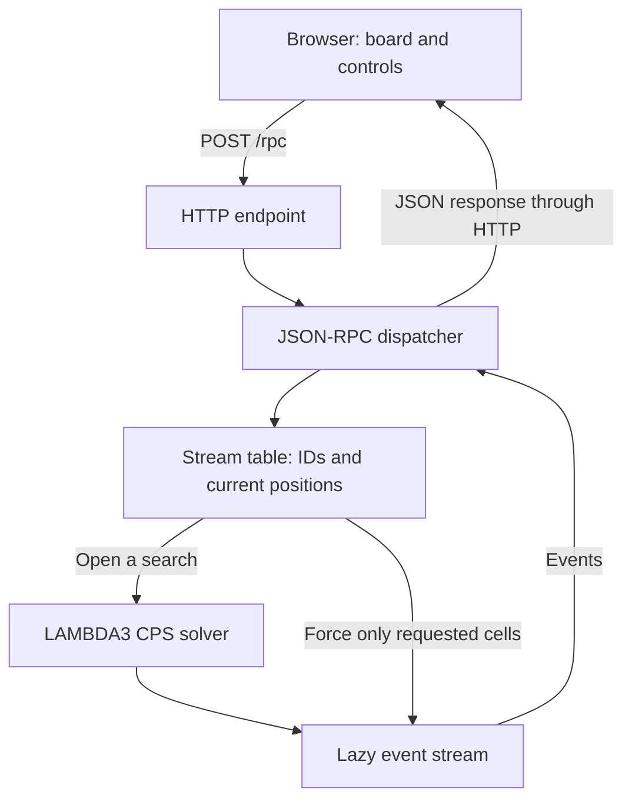

# N-Queens Solver Design

This document describes the planned implementation. The app will use Python
3.12 or later and the supplied LAMBDA3 interpreter. It will run locally.

## 1. Parts of the app

The browser displays the board and asks for more events as needed. The Python
server handles HTTP, validates RPC requests, and keeps track of open streams.
The LAMBDA3 solver produces the search events.



The implementation will keep these responsibilities in separate files:

| Part | Responsibility |
| --- | --- |
| LAMBDA3 solver | Safety checks, CPS search, and lazy event creation |
| Python solver adapter | Load and type-check the fixed solver, force cells, and convert events to JSON |
| Stream manager | Store stream positions, apply limits, and clean up old streams |
| RPC dispatcher | Check envelopes, methods, and parameters; build replies |
| HTTP server | Serve `POST /rpc` and the browser's static files |
| Browser files | RPC requests, playback controls, and board rendering |

The browser will never send LAMBDA3 source or choose a function to execute.

## 2. Solver state and board rules

The search state contains the board size, the next row, the candidate column,
and the queens already placed. Sizes 4 through 10 are allowed; the default is 8.
Rows and columns start at zero.

In events and JSON, a board lists columns in row order. For example, `[1, 3]`
means a queen at row 0, column 1 and another at row 1, column 3.

Inside LAMBDA3, the board will be an immutable list with the newest queen
first. The same example is stored as `[3, 1]`. Adding a queen puts its column
at the front. An event helper reverses this list to make a row-order snapshot.

Every partial board must follow these rules:

- If the next row is `r`, the board contains exactly `r` queens.
- Rows 0 through `r - 1` each contain one queen.
- Every column is between 0 and `size - 1`.
- No two placed queens share a column or a diagonal.
- Earlier board values stay unchanged when a new board is created.

A new candidate is always in the next unused row, so it cannot share a row
with an earlier queen. When checking the newest-first list, `distance` starts
at 1. A previous column conflicts if it equals the candidate column, the
candidate column minus `distance`, or the candidate column plus `distance`.
Each step through the list increases `distance` by 1.

The collision helper also rejects distance zero as a same-row conflict. This
allows a direct safety test even though normal search always visits a fresh row.

Pure helpers will handle board extension, collision comparison, and event
construction. The safety walk itself will use CPS.

## 3. CPS search

A continuation is a function that says what to do next. The search passes
these functions around instead of returning a board or a Boolean to decide
its next step.

These are the planned signatures. `unit` means no useful argument, and
`Strm[Event]` means a lazy stream of events.

```text
Resume = unit -> Strm[Event]
OnSolution = (Board, Resume) -> Strm[Event]

search(size, row, board, on_solution, on_exhausted) -> Strm[Event]
try_column(size, row, column, board, on_solution, on_exhausted) -> Strm[Event]
check_safe(column, distance, board, on_safe, on_conflict) -> Strm[Event]
```

`on_solution` receives a complete board and a function for continuing the
remaining search. `on_exhausted` resumes the enclosing branch when the current
row has no candidates left. `on_safe` and `on_conflict` are also `Resume`
functions. The safety checker calls one of them rather than returning a Boolean.

The following pseudocode uses the internal, newest-first board:

```text
search(size, row, board, on_solution, on_exhausted):
    if row == size:
        return on_solution(board, on_exhausted)
    return try_column(size, row, 0, board, on_solution, on_exhausted)

try_column(size, row, column, board, on_solution, on_exhausted):
    if column == size:
        return on_exhausted()

    return emit_lazy(try_event(column, row, board), lambda():
        check_safe(column, 1, board,
            on_safe = lambda():
                let next_board = prepend(column, board)
                return emit_lazy(place_event(column, row, next_board), lambda():
                    search(size, row + 1, next_board, on_solution,
                        on_exhausted = lambda():
                            emit_lazy(backtrack_event(column, row, board), lambda():
                                try_column(size, row, column + 1, board,
                                           on_solution, on_exhausted)))),
            on_conflict = lambda():
                emit_lazy(reject_event(column, row, board), lambda():
                    try_column(size, row, column + 1, board,
                               on_solution, on_exhausted))))

check_safe(column, distance, board, on_safe, on_conflict):
    if board is empty:
        return on_safe()
    if head(board) conflicts with column at distance:
        return on_conflict()
    return check_safe(column, distance + 1, tail(board), on_safe, on_conflict)

on_solution(board, resume):
    return emit_lazy(solution_event(board), resume)

root_exhausted():
    return emit_lazy(done_event(), lambda(): empty_stream)
```

Each safe candidate explores the entire next-row branch before trying the
next column. The saved failure continuation remembers the earlier board,
emits a backtrack event, and tries that next column. After a solution, the
success continuation leaves the remaining search suspended until requested.
This gives a repeatable depth-first order with no duplicate boards. A
backtrack can occur after a solution as the solver continues looking for more.

Recursive search, safety checks, and continuation calls will be in tail
position: after handing control to the next function, they have no more work
to do. CPS will control the search itself, rather than wrap a direct-style solver.

## 4. Lazy event stream

A stream is a delayed computation. Forcing it produces either an empty result
or a cell containing one event and another delayed stream.

`emit_lazy(event, tail_thunk)` creates a delayed cell. When forced, it returns
the event and a delayed tail. It must not call `tail_thunk` yet. The LAMBDA3
implementation will use `lazy_make`, `lazy_eval`, and stream constructors.

Opening a search stores a delayed call to
`search(size, 0, empty_board, on_solution, root_exhausted)`. It does not run
that call or perform safety checks. Loading and type-checking the fixed solver
can happen once when the server starts.

Forcing one cell does only the work needed to reach the next event. For example,
forcing the tail after a `try` checks that candidate and produces `place` or
`reject`. It leaves later candidates and deeper search suspended. No list of
all solutions or all events is built.

For each requested event, the adapter forces the current stream, converts its
head to JSON, and saves its tail without forcing that tail. A request for
`limit` events repeats this at most `limit` times. Seeing `done` ends the
request immediately; the adapter does not force its empty tail.

Tests will use observable force counters or delayed failures to check that
opening does no search, forcing one cell leaves its tail untouched, and taking
a short prefix does no later work. Larger boards will also be checked.

## 5. Event format

Each event is a JSON object. All boards below are snapshots in row order.
Events with coordinates have integer `column` and `row` fields.

| `event` value | Other fields | Meaning of `board` |
| --- | --- | --- |
| `try` | `column`, `row`, `board` | Board before considering the candidate |
| `place` | `column`, `row`, `board` | Board including the accepted queen |
| `reject` | `column`, `row`, `board` | Unchanged board; the candidate conflicts |
| `backtrack` | `column`, `row`, `board` | Restored board after removing that queen |
| `solution` | `board` | Complete valid board |
| `done` | None | Search has finished |

For example, `{"event":"place","column":3,"row":1,"board":[1,3]}`
places the second queen. A rejected candidate is never added to the board.
There is exactly one `done` event, and it is the final event.

## 6. RPC requests and replies

All requests use `POST /rpc` with `Content-Type: application/json`. Calls use
JSON-RPC 2.0 and receive HTTP 200 with a JSON result or error. The following
examples show a fresh stream. The example UUID stands for a generated ID.

### `service.health`

Request:
```json
{"jsonrpc":"2.0","id":1,"method":"service.health","params":{}}
```
Reply:
```json
{"jsonrpc":"2.0","id":1,"result":{"status":"ok","version":"1.0"}}
```

### `queens.open`

Request:
```json
{"jsonrpc":"2.0","id":2,"method":"queens.open","params":{"size":8}}
```
Reply:
```json
{"jsonrpc":"2.0","id":2,"result":{"stream_id":"c95c59c5-2bee-4c14-a14e-f6ad0df34997","size":8}}
```

### `queens.next`

Request:
```json
{"jsonrpc":"2.0","id":3,"method":"queens.next","params":{"stream_id":"c95c59c5-2bee-4c14-a14e-f6ad0df34997","limit":1}}
```
Reply:
```json
{"jsonrpc":"2.0","id":3,"result":{"events":[{"event":"try","column":0,"row":0,"board":[]}],"done":false}}
```

The reply containing `{"event":"done"}` has `done: true`. Later requests
for that finished ID return `{"events":[],"done":true}` until it expires
or is closed.

### `queens.close`

Request:
```json
{"jsonrpc":"2.0","id":4,"method":"queens.close","params":{"stream_id":"c95c59c5-2bee-4c14-a14e-f6ad0df34997"}}
```
Reply:
```json
{"jsonrpc":"2.0","id":4,"result":{"closed":true}}
```

## 7. Validation, lifetime, and errors

Each stream gets a random UUID. Its table entry stores its current lazy stream,
size, last access time, and completion state. A lock protects cleanup and each
stream operation, so two requests cannot advance the same stream at once.

Streams expire after 10 minutes without a valid `next` or `close` operation.
The server uses a monotonic clock and removes expired entries before handling
each RPC request. Expired state is therefore released on the next request.
Closing removes an entry immediately. Restarting the server loses all IDs.

When `done` is returned, the server releases the solver and its closures. It
keeps only a small completion record so repeated `next` calls can return the
required empty result. This record has the same inactivity lifetime and can
also be closed. Thus exhausted search state is removed without losing the
ability to recognize a recently finished ID.

The dispatcher checks input before creating or advancing a stream:

- The envelope must be an object with `jsonrpc: "2.0"` and a string method.
- An ID, if present, must be a string, number, or null; booleans are invalid.
- Parameters must be an object with exactly the fields listed for the method.
  Missing `params` means `{}`, which is suitable for `service.health` only.
- `size` must be an integer from 4 through 10.
- `limit` must be an integer from 1 through 32.
- Booleans do not count as integers. Stream IDs must be nonempty strings.
- Batch requests are not supported; an array receives an invalid-request error.

| Code | Meaning |
| --- | --- |
| `-32700` | Body is not valid JSON |
| `-32600` | Invalid JSON-RPC envelope |
| `-32601` | Unknown method |
| `-32602` | Invalid parameters |
| `-32603` | Unexpected internal failure |
| `-32001` | Unknown, closed, or expired stream ID |

Error replies preserve a valid request ID. Parse errors and invalid envelopes
use `id: null`. Error messages will be short and will not include tracebacks,
filesystem paths, or interpreter objects. If forcing a stream fails, its state
is removed so it cannot be resumed from a partly completed operation.

A valid notification has no `id`. It runs the requested operation but receives
HTTP 204 with no body, including when the operation encounters an RPC error.
Invalid envelopes still receive an error reply. A notification for `queens.open`
cannot return its ID; its unused stream will expire normally.

## 8. Browser behavior

The initial board is 8 by 8. Changing the size immediately draws a new empty
board and closes any current search. Start opens a fresh stream and animates
to the first solution. Step shows one event when paused.
Play requests events as playback needs them, and Pause stops further requests
after any request already in progress. A speed control changes the delay.
Only one event request for the current search will be in progress at a time.
Play and Next solution keep a buffer of at most 16 events. They request the
next batch only after displaying the current batch; Step requests one event
when the buffer is empty. Pausing keeps any unshown buffered events.

Next solution advances incrementally until a `solution` or `done` event.
Reset closes the old stream and clears the board, log, and solution count.
Replies belonging to an older search are ignored after a reset.

The renderer uses each event's board snapshot. The board is white and gray,
with equal grid rows and columns that do not resize when queens appear.
Event highlights are amber for try, blue for place, red for reject, purple for
backtrack, and green for solution. Candidates also have dotted outlines,
rejections an ×, and backtracks a faint queen with a minus sign. The status,
legend, and log use matching colors. Fixed width constraints, wrapping text,
and reserved scrollbar space keep the page width stable during playback.

A solution pauses playback but does not mean the search is finished. Only
`done` shows completion. Start can begin a fresh search after completion.
Network and RPC errors stop playback and show a readable error with a restart
control. All assets are local; no external account or service is needed.

## 9. Reference code and planned checks

The supplied `eight_queens.lam` and `eight_queens_stream.lam` are references
for collision rules and LAMBDA3 list and lazy-stream operations. They store
rows by column; this design stores columns by row. Their search will need to
be rewritten as CPS with individual events. Any reused code will be identified
in the implementation documentation.

Tests will exercise the actual LAMBDA3 implementation, check all 92 distinct
8 by 8 solutions in deterministic order, verify event snapshots and laziness,
and cover RPC errors, limits, expiration, closing, and repeated reads after
completion. An HTTP test will consume all 92 solutions through the service.
Browser controls and visible errors will have automation or a documented
manual checklist. These are planned checks, not results already obtained.
